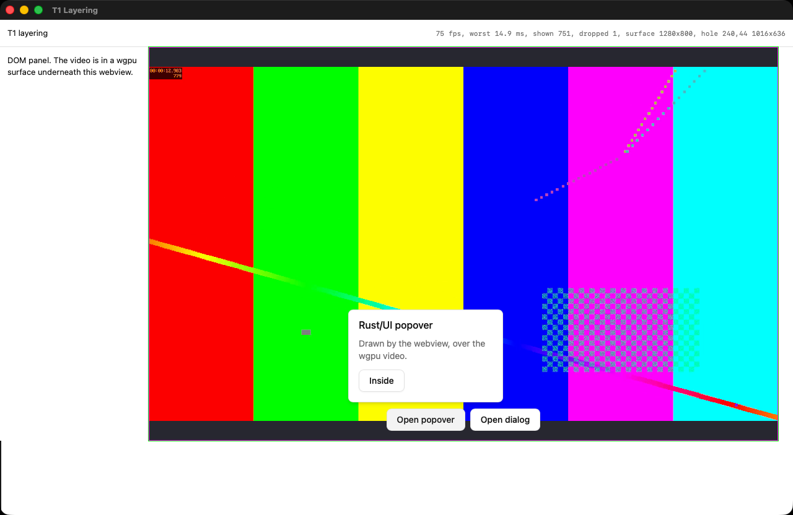
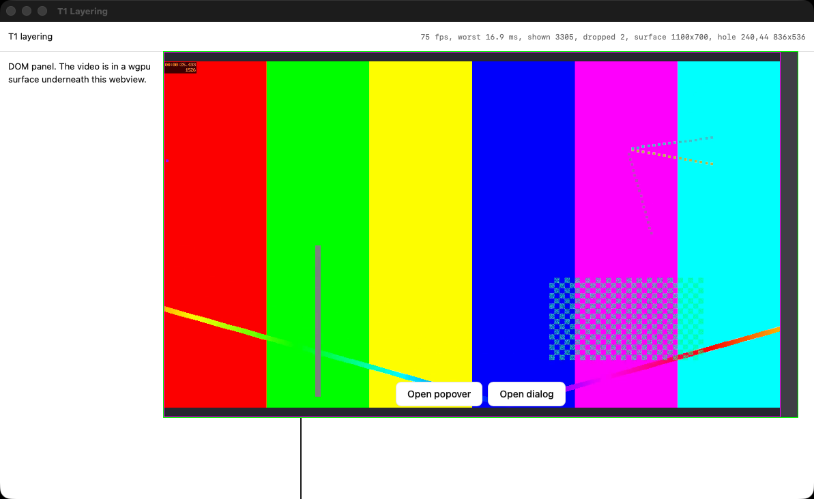

# Go/no-go test results

Results for Milestone 1 of `BUILD_PLAN.md`. The test apps are in `spikes/`.

## T1: Layering

**So far T1 passes on macOS. Windows, X11 and Wayland haven't been run, so T1 stays open.**

Windows matters most, because the plan says to revisit the UI choice if T1 fails there.

| Platform | Result |
|---|---|
| macOS 26.6, Apple M4 Max, 1080p display at 75 Hz | Pass, in 3 runs out of 3 (6 Nov 2026) |
| Windows | Not run. The test app hasn't been compiled there either. |
| X11 | Not run, and needs a code change first. See [Linux](#linux). |
| Wayland | Not run, and not supported by this approach. See [Linux](#linux). |

### What ran

`spikes/t1-layering` plays a 1080p60 H.264 file in a wgpu surface, on its own thread, under a transparent Dioxus webview. The webview shows a header, side panel and timeline around a clear area, as the editor will, plus the vendored Rust/UI Popover and Dialog. Dioxus and wry are the versions Reel pins.

An `ffmpeg` process decodes the frames, which are uploaded as RGBA. Choosing the real decoder is T2's job.

The self-test captures the composited window from the window server and sends mouse events through AppKit, so it checks the pixels on screen and the real path a click takes. All 18 of its checks passed in each of the 3 runs.

### Smooth 1080p60 playback: pass

Over the 3 runs, 5 of 8,568 video frames were dropped and the decoder never fell behind. Presenting held 74.7 to 75.1 fps, which is this display's refresh rate.

| While the page was... | Video fps (lowest run) | Frames dropped (all runs) | Worst frame time, ms |
|---|---|---|---|
| Idle | 59.8 | 2 | 27.2 |
| Showing the popover | 59.9 | 0 | 16.7 |
| Showing the dialog and backdrop | 60.0 | 0 | 16.8 |
| Moving a playhead at 60 Hz | 59.9 | 0 | 17.0 |
| Re-styling 600 elements every frame | 59.9 | 0 | 14.8 |
| Having its main thread blocked for 100 ms, 10 times | 60.0 | 0 | 17.4 |
| Resizing with `set_inner_size` | 59.8 | 0 | 18.4 |
| Resizing through a live drag | 59.7 | 3 | 27.4 |

Frame times are measured when wgpu presents, not when a frame reaches the screen. Rendering on its own thread is what keeps the video independent of the UI, as the blocked-thread row shows.

### DOM controls over the video, receiving clicks: pass

- **Clicks:** the popover trigger, a button inside the popover, the dialog trigger and the dialog's close button all took clicks through AppKit.
- **Clear area:** clicks on bare video reach the DOM too, which the drag handles in step 7.5 need. Clicking there also closes the popover.
- **Drawing order:** in captures, the popover and dialog panels hold still while the video around them moves.
- **Translucency:** the dialog's backdrop halves the video's brightness (×0.50), and the video stays live behind it.

### Alignment through resizing: pass, with one visible effect

Once a resize finishes, the video and the clear area match to the pixel at every size tested. While a window edge is being dragged, the moving edge can lag.

This is the state of each edge across 661 captures from live drags, at up to 785 px/s:

| Edge | Exact | Video continues under the panel, which looks fine | Grey band beside the video |
|---|---|---|---|
| Left, top, bottom (not moving) | 100% | 0% | 0% |
| Right (moving) | 61% | 13% | 25%, typically 14 to 20 px and at worst 28 px |

Percentages don't add up to 100 because of rounding. After each live drag, the edges were exact in a capture taken 400 ms later. After resizing with `set_inner_size`, which allows a closer look, they lined up again within 22 ms.

My call is that this passes, because the band only lasts a few refreshes during a fast drag. It hasn't been looked at by a person yet, so see the hand check in `spikes/t1-layering/README.md`.

### What made resizing work

M6.2 should use these settings:

- **Create the surface in `Config::with_on_window`.** It runs before the webview exists, which puts the Metal layer underneath it.
- **Set the Metal layer's `contentsGravity` to top left, and give it a background colour.** By default, Core Animation stretches the old frame to fit the new size, which moves even the edges that aren't changing.
- **Use `desired_maximum_frame_latency: 1`.** It cost no frame rate here, and lets a new size reach the screen sooner.
- **Report the clear area's rectangle from a `ResizeObserver`.** Reports reached Rust about 2 ms after a resize in most cases, and 22 ms at worst.

From one live-drag run of each setting:

| Frame on the layer | Latency | Left edge exact | Right edge exact | Widest band |
|---|---|---|---|---|
| Stretched (default) | 2 | 12 of 221 | 63 of 221 | 23 px |
| Pinned top left | 2 | 232 of 232 | 25 of 232 | 45 px |
| Pinned top left | 1 | 230 of 230 | 146 of 230 | 23 px |

If the band looks bad by eye, M6.2 could try `presentsWithTransaction` on the layer, which wgpu honours. This test didn't try it.

### Not tested on macOS

- **A real mouse.** Every click and drag was synthesised. They do go through AppKit, and the drags do enter its live-resize loop.
- **Retina, or changing scale.** Both displays here are 1080p at 1×, so M6.2's DPI work starts without evidence.
- **Other refresh rates.** Only 75 Hz was available.
- **macOS below 26.6.** The plan's minimum is macOS 14. T5 and step 5.2 cover the known WebKit differences.
- **Long sessions.** Each run lasts about a minute.

### Linux

This comes from reading the code. Nothing has been run on Linux.

- **Dioxus ignores `with_as_child_window` on Linux.** In `dioxus-desktop` 0.7.9, `webview.rs` only honours it on Windows, macOS, iOS and Android. Elsewhere it always packs the webview into the window's GTK box, so T1 as written can't work there without a patch.
- **wry's `build_as_child` only supports X11.** Its docs say it won't work on Wayland, and recommend `WebViewBuilderExtUnix::new_gtk` with a `gtk::Fixed` to support both.

Both feed into D4.

### Windows

Also from reading the code. wry's own wgpu example turns off `WS_CLIPCHILDREN` through winit. tao has no such setting and never sets that style, so no equivalent should be needed. Only running it will show whether WebView2 really does draw over the surface.

### Findings for later steps

- **The first click on an inactive window is lost (T3, M5).** AppKit only activates the window, and the DOM sees nothing. wry can change this with `with_accept_first_mouse`, but Dioxus doesn't expose it. The launch bar will probably want it.
- **Transparency uses a private API (10.9).** wry sets `drawsBackground` on the webview's configuration through key-value coding. That rules out the Mac App Store, which the plan doesn't target, so check it doesn't get in the way of notarisation.
- **Vendored Popover and Dialog work here.** Their inline scripts run, and CSS anchor positioning works on macOS 26.6. T5 still needs to test the rest.

## T2: Decode

**T2 passes on the reference Mac, and D5 is settled: Reel uses native APIs on macOS.** Windows and Linux choose their own decoder behind the same interface in M11 and M12, with an LGPL FFmpeg build as the default there.

`spikes/t2-decode` decodes 4K60 H.264 into wgpu textures, headless. It compares AVFoundation with FFmpeg's library using VideoToolbox. Both produce the same hardware-backed `CVPixelBuffer`, so the rest of the path is identical. Tested on the M4 Max, with three clips.

### Results

"Zero-copy" wraps the frame's IOSurface as a texture. "Upload" copies the planes with `write_texture`, which is the portable path.

| Clip | Decoder | Decode speed | Real-time 4K60 (10 s) | Seek, median | Seek, worst |
|---|---|---|---|---|---|
| 43 Mbps, keyframe every 1 s | AVFoundation | 663 fps | 0 dropped, 0 late | 99 ms | 132 ms |
| | FFmpeg + VideoToolbox | 152 fps | 0 dropped, 0 late | 236 ms | 430 ms |
| 35 Mbps, keyframe every 4 s | AVFoundation | 680 fps | 0 dropped, 0 late | 259 ms | 399 ms |
| | FFmpeg + VideoToolbox | 161 fps | 0 dropped, 0 late | 934 ms | 1,499 ms |
| 122 Mbps of noise, keyframe every 1 s | AVFoundation | 428 fps | 0 dropped, 0 late | 108 ms | 191 ms |
| | FFmpeg + VideoToolbox | 102 fps | 0 dropped, 0 late | 252 ms | 595 ms |

In real time at 4K60, on either decoder:

| Path | CPU | Work per frame, median | Work per frame, worst |
|---|---|---|---|
| Zero-copy | 0.09 cores | 1.5 ms | 6.4 ms |
| Upload | 0.23 cores | 4.3 ms | 9.5 ms |

- **Correctness:** all 240 seeks landed on the exact frame. Pixels that reached the GPU match a reference from the `ffmpeg` CLI at 52 to 55 dB on luma. The neighbouring frames score about 20 dB, so it is the right frame. Overall PSNR is 33 dB, because this saturated test pattern shows up differences in chroma upsampling. Every path scored the same.
- **Software decoding:** FFmpeg on one thread managed 118 to 131 fps on normal clips and 43 fps on the noise clip, so it's only a fallback.

### Why native on macOS

- **Speed:** about four times the decode speed and two to four times faster seeks, which is what scrubbing feels like.
- **Packaging:** nothing to bundle or sign, and no LGPL relinking duties. Homebrew's FFmpeg is a GPL build, so shipping FFmpeg would have needed a custom build anyway.
- **Encoding:** step 3.8 can use AVAssetWriter, which also writes the fragmented MP4 that step 4.4 needs.

### What this costs

- **WebM import needs another route on macOS.** AVFoundation doesn't read WebM, and the plan keeps WebM import. Leave it out until FFmpeg is added for that alone, or until someone asks for it.
- **Two or three decoders instead of one.** `reel-media` needs a decoder interface with a backend per OS, so Windows and Linux aren't shared with macOS.
- **Keyframe spacing matters.** Seeks scale with it, so step 4.3 should record with a keyframe every second or so.

### Not tested

- **Slower Macs.** Only the M4 Max was available, and the plan's reference is whichever Mac this is. Step 10.9 builds for x64 too, and Intel Macs may behave very differently.
- **HEVC, or other non-H.264 imports.**
- **Variable frame rate.** Screen recordings can be, and this test's clips aren't.
- **Rendering to a window.** T1 covered that with a simple uploader, and step 3.1 joins them up.

## Running test apps on macOS

These cost time during T1, and will apply to later tests too.

- **Keep a test app's files out of `~/Documents`.** This repo is under it, and macOS protects that folder. Each build is a new ad-hoc identity, so a file read from there shows a permission prompt after every rebuild and blocks until someone answers it. That looks like a slow start and a window that keeps losing focus. T1's `run.sh` works from `~/Library/Caches/reel-spikes/` and copies results back.
- **Rebuild the `.app` rather than overwriting its binary.** Launches failed with error 162, "Codesigning issue", on a bundle whose binary had been overwritten with `cp`. Deleting the bundle, copying the binary into a new one and signing it with `codesign --force --sign -` stopped that, though this didn't separate which part mattered. `launchctl error <n>` translates these codes.
- **An app can capture its own window without the Screen Recording permission.** `CGWindowListCreateImage` returns the real composite, including Metal layers and the webview, with no prompt. The SDK marks it obsolete from macOS 15, but it's still exported, so declare it by hand.
- **Posted mouse events can drive a real live resize.** Call `postEvent:atStart:` from another thread, because the main thread stays inside AppKit's resize loop for the whole drag.
- **Synthetic clicks can't take focus.** A click on a window that isn't key is lost, and macOS may refuse to give focus back to an app that gave it up, so T1's self-test flags such runs as inconclusive.
- **`open -W` always exits 0.** Read the result from a report file instead.
